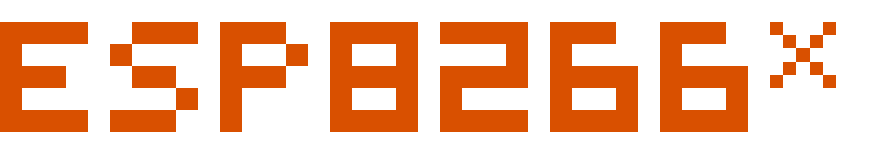

<div align="center">
  
</div>

Setup Toolchain for esp8266 legacy: [https://docs.espressif.com/projects/esp8266-rtos-sdk/en/latest/get-started/macos-setup.html](https://docs.espressif.com/projects/esp8266-rtos-sdk/en/latest/get-started/macos-setup.html)

compiler for esp8266: [https://dl.espressif.com/dl/xtensa-lx106-elf-gcc8_4_0-esp-2020r3-macos.tar.gz](https://dl.espressif.com/dl/xtensa-lx106-elf-gcc8_4_0-esp-2020r3-macos.tar.gz)


projcet compile:
```bash
  make COMPILE=gcc BOOT=new APP=1 SPI_SPEED=40 SPI_MODE=QIO SPI_SIZE_MAP=5 PYTHON=python2
```
